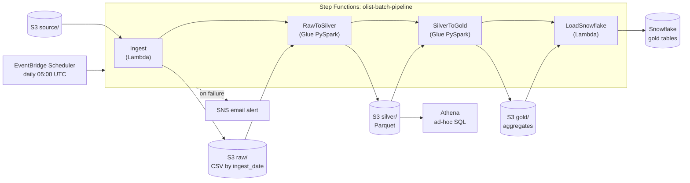

# Olist E-Commerce Data Pipeline (AWS + Snowflake)

A batch data pipeline built on AWS and Snowflake. It takes raw e-commerce CSV files, cleans them, builds summary tables and loads them into Snowflake. It runs automatically every day and sends an email if something fails. All infrastructure is created with Terraform.

**Live dashboard:** _link coming soon_

## Overview

- **Data:** Olist Brazilian e-commerce dataset from Kaggle (about 100,000 orders, 9 CSV tables)
- **What it does:** raw CSV -> cleaned Parquet -> summary tables -> Snowflake
- **Runs:** every day at 05:00 UTC, takes about 4 minutes
- **Alerts:** an email is sent on any failure

## Architecture



## Pipeline steps

1. **Ingest (Lambda):** copies the CSV files from `source/` into `raw/olist/ingest_date=YYYY-MM-DD/` inside S3. The date is passed to the next steps.
2. **Raw to silver (Glue, PySpark):** cleans the data. Trims text, converts empty values to nulls, fixes data types, removes duplicates, fixes misspelt column names, and writes Parquet to `silver/`.
3. **Silver to gold (Glue, PySpark):** builds summary tables (daily sales, delivery performance) and writes them to `gold/`.
4. **Load to Snowflake (Lambda):** connects to Snowflake with a key pair, reloads the gold tables from S3, and checks that no table is empty.
5. **Failure alert (SNS):** if any step fails, Step Functions sends the error by email and the run is marked failed.

## Data layers

| Layer | Location | Format |
|---|---|---|
| source | `source/olist/` | CSV |
| raw | `raw/olist/ingest_date=.../` | CSV |
| silver | `silver/olist/<table>/ingest_date=.../` | Parquet |
| gold | `gold/` | Parquet |
| warehouse | Snowflake `olist_db.gold` | Tables |

Silver tables can also be queried in Athena. Partition projection is used, so new daily folders show up without a crawler.

## Dataset

| Table | Rows after cleaning |
|---|---|
| orders | 99,441 |
| customers | 99,441 |
| order_items | 112,650 |
| order_payments | 103,886 |
| order_reviews | 99,224 |
| products | 32,951 |
| sellers | 3,095 |
| geolocation | 738,332 |
| category_translation | 71 |

## Tech stack

- **Storage:** Amazon S3
- **Processing:** AWS Glue (PySpark), AWS Lambda (Python)
- **Orchestration:** AWS Step Functions, EventBridge Scheduler
- **Querying:** Amazon Athena, Snowflake
- **Alerts:** Amazon SNS
- **Security:** IAM roles per service, Snowflake storage integration, key-pair login with the private key in SSM Parameter Store
- **Infrastructure as code:** Terraform

## Features

- Runs automatically every day, no manual steps
- Safe to re-run: each run overwrites only its own `ingest_date` folder, so no duplicates. An old day can be replayed with `{"ingest_date": "2026-10-02"}`
- Empty tables stop the load and trigger an alert
- No secrets in code or Terraform state
- Whole stack is created and destroyed with Terraform
- Low cost: small Glue jobs, Snowflake XS warehouse with auto-suspend and a credit limit, AWS budget alert

## Project structure

```
.
├── main.tf                  # S3 bucket, budget alert
├── iam.tf                   # SNS topic, Lambda and Glue roles
├── snowflake.tf             # IAM role for Snowflake to read S3
├── glue.tf                  # raw-to-silver Glue job
├── gold.tf                  # silver-to-gold Glue job
├── ingest.tf                # ingest Lambda
├── lambda.tf                # Snowflake load Lambda
├── sfn.tf                   # Step Functions pipeline
├── schedule.tf              # daily schedule
├── glue_raw_to_silver.py
├── glue_silver_to_gold.py
├── lambda_ingest.py
├── lambda_snowflake_load.py
├── build_lambda.sh          # packages the Snowflake connector for Lambda
└── terraform.tfvars.example
```

## Challenges

- **Snowflake to S3 connection needs two Terraform applies.** Snowflake gives its AWS user and external ID only after the integration is created, so the IAM role starts with a placeholder and is updated afterwards.
- **Lambda needs a Linux build.** My laptop's Python is newer than the Lambda runtime, so the build script downloads packages made for Linux and Python 3.12.
- **Athena without a crawler.** Partition projection removed the need for a Glue Crawler or a repair command after every load.
- **Glue argument names.** The two Glue jobs read the date under different names (`INGEST_DATE` and `ingest_date`), so Step Functions passes each one its own.
- **Small files.** Spark wrote small tables as several tiny Parquet files. It does not matter at this size, but `coalesce` would fix it on bigger data.

## Next steps

- Data quality checks between silver and gold
- dbt models and tests on Snowflake
- Incremental loads instead of a full daily copy
